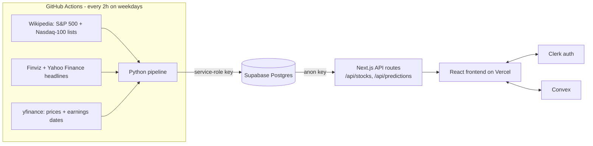

# Vestra

Vestra is a stock analysis web app for the ~100 largest US stocks. A scheduled Python pipeline scrapes recent news headlines, scores their sentiment, forecasts each stock's price 30 days ahead with an uncertainty band, and stores the results in Postgres. A Next.js frontend reads that data through its own API routes and shows rankings, sentiment, and interactive price/forecast charts.

Live: [vestraii.vercel.app](https://vestraii.vercel.app)

## Features

- **Interactive price chart:** 90 days of price history plus a 30-day forecast with upper and lower 95% bounds
- **Sentiment ranking:** the top ~100 stocks by market cap, ranked and labelled Bullish / Neutral / Bearish from news headlines
- **Prediction list:** the largest predicted increases and decreases
- **Watchlist:** a per-stock view with current price, prediction and sentiment
- **Sign-in:** user accounts via Clerk

## Architecture



The system is split in two:

1. **Batch backend (write side):** a Python job runs on a schedule, does all the heavy work (scraping, NLP, forecasting), and writes the finished results to the database. Nothing expensive happens when a user loads a page.
2. **Web app (read side):** Next.js serves the UI, and its API routes run read-only queries against the precomputed data.

Because the two halves only share the database, either side can change without touching the other. Scraping and rate limits can also never slow down a page load.

## Technologies

### Frontend

| Technology | What it is | How Vestra uses it |
|---|---|---|
| **Next.js 15 (App Router)** | React framework with file-based routing, server rendering and built-in API routes | Pages live in `app/` (`/`, `/watchlist`, `/pricing`). `app/api/*/route.ts` files are the backend endpoints. Turbopack handles dev and build. |
| **React 19** | UI component library | Interactive components such as `StockChart`, `SentimentTable` and `WatchlistBar` fetch from the API with `useEffect` and keep data in `useState`. |
| **TypeScript** | JavaScript with static types | Interfaces for API responses (e.g. `StockData`, `Prediction`) catch shape mismatches at compile time. |
| **Tailwind CSS v4** | Utility-first CSS | All styling is done with utility classes; there are no separate stylesheets beyond `globals.css`. |
| **shadcn/ui + Radix UI** | Copy-in component recipes built on accessible, unstyled Radix primitives | `components/ui/` holds the sidebar, dialogs, dropdowns, tooltips and switches. Radix handles keyboard and ARIA behaviour. |
| **TradingView Lightweight Charts** | Canvas-based financial charting library | `StockChart.tsx` draws the historical price line, the forecast line and the upper/lower band series. |
| **Lucide React** | Icon set | Sidebar and UI icons. |
| **Skeleton loaders** | Placeholder components | `components/skeletons/` shows layout-matched placeholders while data loads. |
| **Vercel Analytics** | Privacy-friendly page analytics | `<Analytics />` in the root layout. |

### Web backend (API layer)

| Technology | What it is | How Vestra uses it |
|---|---|---|
| **Next.js Route Handlers** | Serverless functions defined in `app/api/**/route.ts` | `GET /api/stocks` returns all ranked stocks with their predicted % change. `GET /api/stocks?ticker=AAPL` returns one stock's history, forecast and bands. `GET /api/predictions` returns the top predicted movers. They run as serverless functions on Vercel. |
| **supabase-js** | Client library for Supabase's auto-generated REST API (PostgREST) | The API routes query the `stocks`, `stock_prices` and `stock_predictions` tables with the public anon key, which has read-only access. |
| **Clerk** | Hosted authentication (sign-up, sign-in, sessions, user profiles) | `ClerkProvider` wraps the app, `middleware.ts` runs `clerkMiddleware()` on every request, and the sidebar uses `useUser()` to show the signed-in user. |
| **Convex** | Reactive backend-as-a-service database with live queries | Connected through `ConvexProviderWithClerk`, so Convex receives Clerk's JWT and can identify users (`ctx.auth.getUserIdentity()` in `convex/messages.ts`). It's currently a scaffold for per-user data such as saved watchlists; stock data lives in Supabase. |

### Database: Supabase (PostgreSQL)

Supabase is hosted Postgres with an auto-generated REST API and API keys:

- **service-role key:** used only by the pipeline, in GitHub Actions secrets; bypasses row-level security to write.
- **anon key:** used by the web app to read.

| Table | Columns | Rows |
|---|---|---|
| `stocks` | `ticker` (PK), `name`, `sentiment` (JSON: score, category, investment_score), `news_count`, `rank`, `investment_score`, `last_updated` | ~100, one per stock |
| `stock_prices` | `ticker`, `date`, `price` | ~60 trading days per stock |
| `stock_predictions` | `ticker`, `date`, `price`, `upper_bound`, `lower_bound` | ~21 forecast trading days per stock |

On each run the pipeline upserts every stock, replaces its price and prediction rows, and deletes stocks that have dropped out of the top 100.

### Data pipeline (`scripts/stock-analysis/`, Python)

| File | Role |
|---|---|
| `main.py` | Entry point: runs the analysis, then writes to the database |
| `webscrape.py` | Picks the universe (S&P 500 + Nasdaq-100 from Wikipedia, top 100 by market cap via yfinance), scrapes Finviz and Yahoo headlines, and fetches prices and earnings dates |
| `sentiment_analysis.py` | Scores headlines with NLTK VADER plus a finance word list |
| `predict.py` | Builds the 30-day forecast and uncertainty bands |
| `generate_data.py` | Orchestrates per-stock analysis and ranking |
| `database.py` | Supabase writes |
| `backtest.py` | Walk-forward evaluation of the forecasting model |
| `config.py` | Settings, environment variables and the finance word list |

**Libraries:**
- **pandas / NumPy:** time-series handling and maths.
- **yfinance:** Yahoo Finance prices, market caps, earnings dates and news search.
- **requests + BeautifulSoup:** HTML scraping of Finviz and Wikipedia.
- **NLTK VADER:** rule-based sentiment scoring.
- **supabase-py:** database writes.

**Scheduling:** `.github/workflows/github-actions.yml` runs the pipeline every 2 hours on weekdays and every 6 hours at weekends. GitHub disables scheduled workflows after 60 days with no repository activity, so each run calls the GitHub API to re-enable itself and reset that timer. The regular writes also keep the free-tier Supabase project from pausing.

## How the analysis works

### 1. Sentiment

1. Up to ~100 recent headlines are collected per stock from Finviz, plus Yahoo Finance headlines that actually name the company. Duplicates are removed.
2. Each headline is scored by **VADER**, a lexicon- and rule-based sentiment model that handles negation ("not good"), intensifiers ("very") and punctuation. It's extended with finance terms ("upgrade", "misses", "bearish"). Positive and negative pairs carry equal weight so the word list doesn't skew bullish.
3. The average compound score (−1 to +1) gives the label: Bullish ≥ 0.05, Bearish ≤ −0.05, otherwise Neutral.

### 2. Price forecast

The forecast treats the price as a **lognormal random walk**:

- **Expected path:** a long-run market drift of about 7.5% a year, plus a small tilt from news sentiment. The tilt is scaled by how many articles back it up.
- **Uncertainty:** daily volatility is a 50/50 blend of a recent estimate (EWMA, λ = 0.94) and the last year's volatility. It's measured on ordinary days only, excluding earnings days.
- **Earnings:** stocks move much more on earnings days. Each stock's typical earnings-day move is estimated from its last 8 reports. If a report is scheduled inside the forecast window, that move is added on that day, so the band visibly widens there.
- **Bands:** the band is ±1.96 standard deviations, widening with the square root of time. That gives a 95% interval.

### 3. Validation

`backtest.py` replays history: at each point in time it forecasts using only data available then, and compares the forecast with what actually happened. Results over 50 stocks and 3,650 forecasts:

| | Price stays flat | Previous model | Current model |
|---|---|---|---|
| Mean absolute error | 6.77% | 11.54% | **6.70%** |
| Actual price inside the 95% band | n/a | 20.4% | **94.3%** |
| Interval score (lower = better) | n/a | 333 | **43** |

Things were tested and dropped as well. Momentum, technical indicators (moving averages, 52-week highs, volatility), pooled ridge regression and post-earnings-announcement drift were all evaluated on a held-out period. None beat a constant drift out of sample, so they aren't used. The main gain is honest uncertainty: the bands are calibrated and narrower when no earnings are due.

**Limitations:**
- Historical headlines aren't available, so the sentiment tilt can't be backtested.
- The test universe is today's large caps, which introduces survivorship bias.
- This is not investment advice.

## Running locally

**Web app:**

```bash
npm install
# .env.local
#   NEXT_PUBLIC_SUPABASE_URL, NEXT_PUBLIC_SUPABASE_ANON_KEY
#   NEXT_PUBLIC_CLERK_PUBLISHABLE_KEY, CLERK_SECRET_KEY
#   NEXT_PUBLIC_CONVEX_URL, CLERK_FRONTEND_API_URL (set in the Convex dashboard)
npm run dev
```

**Pipeline:**

```bash
cd scripts/stock-analysis
pip install -r requirements.txt
python main.py        # needs SUPABASE_SERVICE_ROLE_KEY + NEXT_PUBLIC_SUPABASE_URL
python backtest.py    # no database needed
```

The pipeline can also be triggered on GitHub with `gh workflow run "Stock Analysis Pipeline"`.

## Project structure

```
app/                    Next.js pages and API routes
  api/stocks/           GET all stocks / one stock's history + forecast
  api/predictions/      GET biggest predicted movers
  watchlist/, pricing/  Pages
components/             React components (chart, tables, sidebar, skeletons, shadcn ui/)
convex/                 Convex functions + Clerk auth config
middleware.ts           Clerk middleware
scripts/stock-analysis/ Python data pipeline
.github/workflows/      Scheduled pipeline
```
